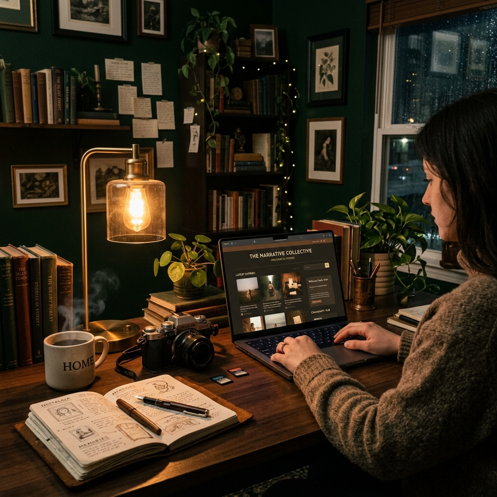

# AD 1 — “THE INTERNET USED TO FEEL HUMAN”

## [CONCEPT]
A transition from the digital exhaustion of the modern web to the slow, intentional, and human-centric world of RuralAndReckless.com.

## [VISUALS]
- **00:00 - 00:05**: Fast-cut montage. Glitchy blue light, scrolling phones, "Buy Now" overlays, blurred influencer faces, red notification bubbles. (Chaotic/Burnout mood).
- **00:05 - 00:06**: Hard cut to BLACK. Complete silence.
- **00:06 - 00:15**: Slow, cinematic pan across an espresso-brown wooden desk. A warm amber lamp flickers. We see a person’s hand sketching in a thick parchment-paper notebook. 
- **00:15 - 00:25**: Close-up of a laptop screen displaying the RuralAndReckless marketplace. It looks cozy, with deep forest green accents and artisan listings (photography, hand-bound books). 
- **00:25 - 00:30**: A real human smile, softly lit by the warm glow of the screen. 
- **Ending**: The RuralAndReckless logo fades in over a dark green background.

## [AUDIO]
- **Intro**: Digital static, overlapping notifications, high-pitched "ping" sounds, fast-paced electronic beat.
- **Transition**: Submerged sound, then absolute silence for one second.
- **Main**: Soft, acoustic folk guitar. Warm, grounded melody. The sound of a pen scratching on paper and the soft hum of a coffee shop.
- **Narration**: (Deep, warm, calm voice) 
  *"The internet used to feel human."* (Pause) 
  *"Maybe it still can."*

## [TEXT OVERLAYS]
- 00:20: **CREATORS.**
- 00:22: **COMMUNITY.**
- 00:24: **MARKETPLACE.**
- 00:28: **RuralAndReckless.com**

## [AI VIDEO GENERATION PROMPTS]
1. **Scene A (Chaos)**: "Fast montage of glitched digital screens, blue light scrolling, social media notification chaos, high contrast, blurry frantic energy."
2. **Scene B (The Workspace)**: "Cinematic vertical 9:16. Slow pan of a cozy artisan studio at night. Dark forest green walls, espresso wooden desk, vintage amber lamp. 8k, realistic textures."
3. **Scene C (The Interaction)**: "Close-up of a laptop screen showing a cozy creator community website with green and cream colors. Warm lighting, cinematic bokeh."

---

