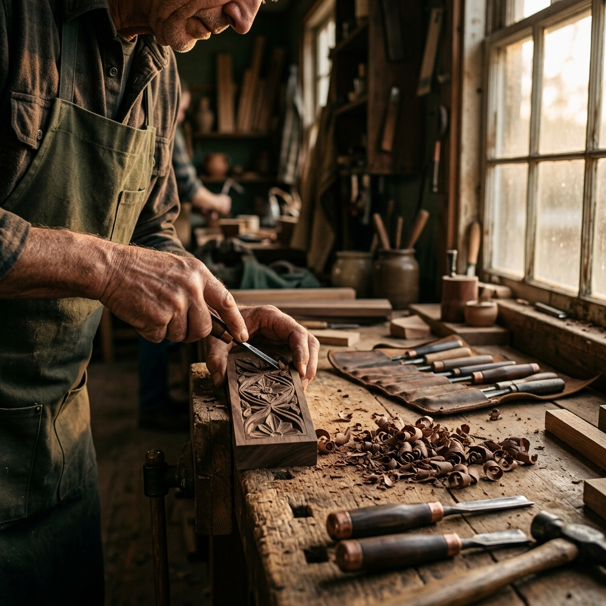

# AD 2 — “COZY CREATOR MARKETPLACE”

## [CONCEPT]
Showcasing RuralAndReckless.com as the home for artisans who are tired of the "big tech" marketplace grind. It’s a space to sell work to people who care about the story.

## [VISUALS]
- **00:00 - 00:07**: A woodworker in a sun-drenched, dusty studio. We see the frustration—a stack of unsold items and a confusing "Corporate Seller Dashboard" on a screen.
- **00:07 - 00:15**: The woodworker closes the corporate tab and opens RuralAndReckless.com. The interface is warm, simple, and artistic. 
- **00:15 - 00:25**: Montage of "The Market": 
    - A painter's messy palette.
    - A musician uploading a raw track.
    - Someone browsing a "Handcrafted" section on the site.
- **00:25 - 00:30**: Connection. A notification pops up: "New Message from a Supporter." The creator looks relieved.

## [AUDIO]
- **Mood**: Hopeful, grounded, cinematic indie music. Think ambient percussion and warm pads.
- **Sound Design**: The "clack" of a keyboard, the sound of a wood plane carving, the soft chime of a genuine message.
- **No Narration**: Focus on the visual storytelling and the text overlays.

## [TEXT OVERLAYS]
- 00:10: **SELL YOUR WORK.**
- 00:15: **FIND YOUR PEOPLE.**
- 00:20: **BUILD SOMETHING REAL.**
- 00:28: **RuralAndReckless.com**

## [AI VIDEO GENERATION PROMPTS]
1. **Scene A (The Struggle)**: "Cinematic close-up of a frustrated woodworker in a rustic shop, dust motes in golden light, espresso wood tones, emotional realism."
2. **Scene B (The Platform)**: "A vertical UI mockup of a cozy creator marketplace, forest green and parchment cream color palette, high-quality product photos of ceramics and woodcraft."
3. **Scene C (The Result)**: "Over the shoulder shot of a creator looking at a warm, inviting community profile on a screen. Soft amber lighting, blurred background of a creative studio."

---

