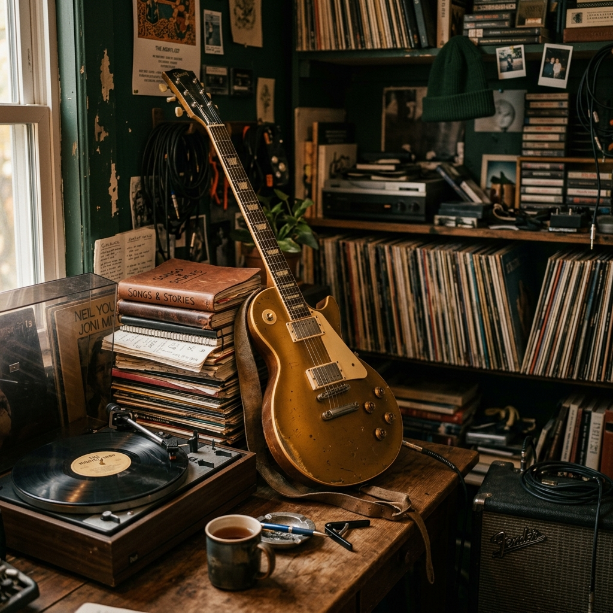

# AD 3 — “NOT EVERYTHING NEEDS TO BE PERFECT”

## [CONCEPT]
A direct rejection of "Influencer" culture. This ad celebrates the messy, raw, and authentic reality of being a creator.

## [VISUALS]
- **00:00 - 00:06**: Overproduced, hyper-saturated video of someone in a fake "perfect" studio. Perfect hair, fake smile, ring light reflected in eyes. (Cringe/Fake mood).
- **00:06 - 00:07**: A "glitch" effect leads into a hard cut.
- **00:07 - 00:20**: A series of "Real" creator moments:
    - A musician fumbling a chord and laughing.
    - A desk covered in coffee rings and half-finished sketches.
    - A woodworker with sawdust on their face.
    - A simple, non-polished profile on RuralAndReckless.com.
- **00:20 - 00:25**: People interacting in the community feed—genuine comments, no bots.
- **00:25 - 00:30**: A person closing their eyes and just breathing in a quiet room.

## [AUDIO]
- **Intro**: High-energy, generic "royalty free" corporate pop (briefly).
- **Transition**: Record scratch or tape stop.
- **Main**: Lo-fi, warm piano or acoustic guitar. Very intimate and "close to the mic."
- **Narration**: (Soft, whispered or very low voice)
  *"Not everything needs to be polished."* (Pause)
  *"Some things just need to be real."*

## [TEXT OVERLAYS]
- 00:27: **RuralAndReckless.com**
- 00:28: **FOR REAL CREATORS.**

## [AI VIDEO GENERATION PROMPTS]
1. **Scene A (The Fake)**: "Saturated vertical video of a generic influencer in a bright white studio, fake smile, ring light reflection, corporate aesthetic."
2. **Scene B (The Real)**: "Cinematic vertical shot of a messy music studio, vintage guitar, espresso tones, soft amber light, realistic clutter, emotional realism."
3. **Scene C (The Human)**: "Authentic shot of a person laughing naturally in a dark forest green room, grounded lighting, 8k, high detail."

---

